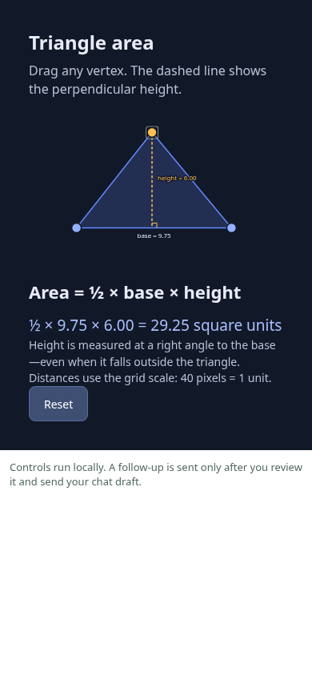
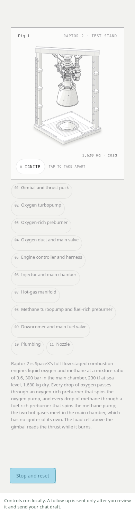

# Interactive UI and Anatomy for Aether

Ask a question and get a visual you can use inside the conversation: drag a vertex,
change a parameter, inspect a mechanism, or explore a simulation. Aether's existing
Pi agent creates the HTML/SVG/Canvas for your question. Controls calculate locally;
they do not make another model request each time you touch them.

## See it in use

The examples below show concrete rendering and interaction checks. Each capture is labelled with its actual environment.

<p></p>

Left: an actual model-generated triangle captured in desktop Chromium at a phone
viewport. Tests drag a vertex, check the calculated area, use the keyboard and reset.
Right: the upstream Anatomy engine reference in the same browser viewer, testing
part selection and reset. These are renderer tests, **not screenshots proving the
new native inline flow**. Physical Android interaction and iOS verification remain
with the device tester. See [test prompts and pass criteria](docs/TESTING.md).

## Two independent extensions

| Extension      | Tool             | Composer menu  | Storage                    |
| -------------- | ---------------- | -------------- | -------------------------- |
| Interactive UI | `render_ui`      | Interactive UI | `~/.aether/interactive-ui` |
| Anatomy        | `render_anatomy` | Anatomy        | `~/.aether/anatomy`        |

Install either or both. Each has its own package manifest, tool, message type and saved figures. Shared renderer code lives once in this source repository and is included in each standalone ZIP.

## Try it

Ask naturally, for example:

> Explain why a triangle's area is half its base times its height. Give me an
> interactive diagram with a draggable vertex and live measurements.

> Show how changing mass and acceleration changes the net force. Let me adjust
> both values and explain the assumptions.

> Explain a pump with a detailed isometric drawing. Let me select its parts.

There is no named-demo command to remember. The agent chooses an appropriate
visual and calls the corresponding rendering tool. Its short `promptSnippet` advertises the tool;
focused authoring guides load only when requested. Anatomy injects its SVG toolkit only into its own figures; Interactive UI does not ship that module. Each extension’s
composer menu reopens saved figures in the current chat.

## Install

Import either [release ZIP](https://github.com/josephm1/aether-visuals/releases) through
**Aether → Settings → Extensions → Import extension**, enabling its Pi and Aether
parts. Node 22+ is required by the runtime.

Inline display requires the generic Pi custom-message support in
[Aether host support's inline-messages branch](https://github.com/josephm1/aether-host-support/tree/feature/inline-extension-messages).
This Android host change is not yet in upstream Aether. The corresponding iOS
custom-message path is connected in source; iOS hardware validation remains pending.
The Apps extension is not required.

## How it works

1. Each extension registers its own rendering tool. The model supplies self-contained
   `content` and a `title`. `action: guide` optionally loads
   that extension’s focused authoring guide; `action: list` lists saved metadata.
2. The tool saves an immutable local HTML snapshot. Its model-facing `content`
   contains a small result; structured `details` preserve metadata.
3. Pi's standard `sendMessage(..., { triggerTurn: false })` persists a display
   message containing the artifact ID. The native host renders it inline in its
   originating chat. No file scan, polling or extra model turn is used.
4. The viewer reports its content height so chat can scroll through the whole
   document. The explanation, controls and subsequent conversation stay together.
5. A visual can propose a follow-up with selected scalar values. You review it,
   approve a chat draft, and send it yourself.

This follows [Pi's extension API](https://github.com/earendil-works/pi/blob/main/packages/coding-agent/docs/extensions.md):
registered tools, model-facing content, rendering/state details and persisted custom
messages. [pi-render](https://github.com/ElieMessieCode/pi-render) demonstrates the
same generated-HTML approach in a desktop browser. Aether supplies the native chat
renderer instead of starting that project's separate browser server.

## Context and storage

No drawing kit, saved visual, conversation history or book corpus is loaded at
activation. The tool has a compact schema and one-line prompt hint. Authoring guides
and toolkit files are read on demand. HTML is not repeated in tool results or
follow-ups. A provider-context transform replaces earlier visual tool arguments with
a short marker, preserving the original persisted branch. Editing can retrieve one
selected source page at a time with `action: read` (6,000 characters maximum). Pi's display message adds only a title and artifact ID to the session.
Generating elaborate code still costs model output tokens; local controls cost none.

Snapshots live under its own `~/.aether/interactive-ui` or `~/.aether/anatomy` directory, independently committed with SHA-256.
The library reads metadata only and lists the latest 20 saved figures. Displaying
one verifies its content. Older files remain stored. Documents are limited to 2 MiB;
follow-ups to 1,200 text characters and 1 KiB of up to 16 scalar selected values.
These are byte/character bounds, not measured model token counts.

## Rendering and isolation

The viewer supports self-contained HTML, CSS, JavaScript, SVG, Canvas and WebGL.
The optional MIT Anatomy SVG geometry module supports intricate isometric figures. Toolkit SVG bounds expand to contain their visible geometry, with paint clipped to the drawing frame so parts cannot spill over controls. Generation
must provide touch controls, readable labels, keyboard access, reset/pause controls
where appropriate, and reduced-motion support.

Generated content runs in an opaque-origin `sandbox="allow-scripts"` iframe with
CSP restrictions on external resources, nested frames, forms, workers, popups,
network requests and eval. It cannot read the parent DOM. The parent accepts
bounded size and follow-up messages only. Native action IDs are random and remain
outside generated documents. Android/iOS may inject their generic bridge into
subframes, so sandboxing alone is not treated as hiding that bridge.

The approved follow-up action creates a draft; it cannot automatically send a
message, invoke the model, read files or install anything. Diagrams and calculations
need validation; generated scientific content is not verified guidance.

## Scope and validation

This implements interactive-answer capabilities using Aether's selected model and
authentication. It includes a small MIT OpenIntelligentUI style subset, not its
Next.js/CopilotKit backend. No router model, extra provider SDK, separate credentials,
telemetry, cloud service or background server is installed.

Local tests cover document integrity and content bounds, Pi message shape, inline
rendering, content-height reporting, real calculator/gauge/engine controls, keyboard
and phone-width interaction, isolation and reviewed follow-ups. Native Android
custom-message tests and builds are separate from browser tests. Device captures
state the workflow actually exercised; they do not establish iOS parity, scientific
correctness or complete WebGL performance coverage.

## Development

```sh
npm ci --ignore-scripts
npm test
CHROME_PATH=/path/to/chromium npm run test:browser
npm run package
AETHER_EXTENSION_BRIDGE=/path/to/Aether/pi-bridge/dist/extension-bridge.mjs npm run test:host
```

Runtime uses Node built-ins only. Puppeteer is a development dependency. Packaging
allowlists runtime files and excludes dependencies, tests, screenshots, generated
snapshots and credentials. Force, dial and engine examples live only under tests/fixtures;
they are not special cases exposed to the model. Only the browser-safe SVG module is shipped; unused desktop build, publishing and 3D tooling are excluded.

## Licences

Original adapters and shared renderer: MIT. Pinned upstream revisions and original licences are in:

- [Anatomy](https://github.com/wheresryan22/anatomy): `vendor/anatomy/UPSTREAM.json`
  and `LICENSE`. The SVG module retains upstream code; desktop publishing/build scripts are excluded.
- [OpenIntelligentUI](https://github.com/CopilotKit/OpenIntelligentUI):
  `vendor/open-intelligent-ui/UPSTREAM.json` and `LICENSE`. The CSS subset comes
  from `packages/design-system/src/index.ts`.
